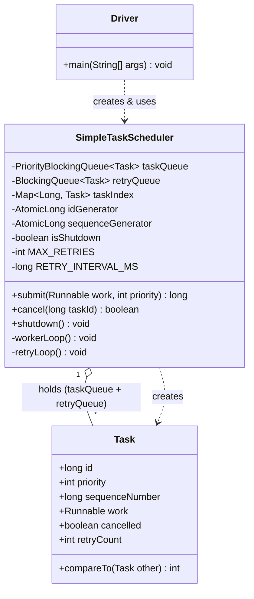

# Simple Task Scheduler — LLD / UML

Classes: `Task`, `SimpleTaskScheduler`, `simple_task_scheduler` (driver/main).

## Class diagram



## Box diagram (plain text)

```
┌───────────────────────────────────┐
│              Driver                │
│─────────────────────────────────── │
│ + main(String[] args): void        │
└───────────────────┬─────────────────┘
                    │ creates & uses
                    ▼
┌───────────────────────────────────────────┐
│           SimpleTaskScheduler               │
│───────────────────────────────────────────  │
│ - taskQueue: PriorityBlockingQueue<Task>    │
│ - retryQueue: BlockingQueue<Task>           │
│ - taskIndex: Map<Long, Task>                │
│ - idGenerator: AtomicLong                   │
│ - sequenceGenerator: AtomicLong             │
│ - isShutdown: boolean                       │
│ - MAX_RETRIES: int                          │
│ - RETRY_INTERVAL_MS: long                   │
│───────────────────────────────────────────  │
│ + submit(work, priority): long              │
│ + cancel(taskId): boolean                   │
│ + shutdown(): void                          │
│ - workerLoop(): void                        │
│ - retryLoop(): void                         │
└───────────────────┬─────────────────────────┘
                    │ holds (1 ── * )   creates ▷
                    ▼
┌───────────────────────────────────┐
│                Task                 │
│─────────────────────────────────── │
│ + id: long                          │
│ + priority: int                     │
│ + sequenceNumber: long              │
│ + work: Runnable                    │
│ + cancelled: boolean                │
│ + retryCount: int                   │
│─────────────────────────────────── │
│ + compareTo(Task other): int        │
│   (implements Comparable<Task>)     │
└─────────────────────────────────────┘
```

Legend: `─▷` dependency (creates), `1──*` composition (owns via taskQueue + retryQueue).

## Relationship notes (for talking through in an interview)

- **Composition (has-a):** `SimpleTaskScheduler` *has-a* `taskQueue` and a `retryQueue`, both holding `Task` objects. The queues are internal state — a `Task` doesn't exist meaningfully outside the scheduler that owns it, so this is composition, not just association.
- **No inheritance / no "is-a" here on purpose.** This design deliberately avoids an `AbstractTask` / `Task` subclass hierarchy or a `Retryable` interface — everything is one concrete `Task` class with a `retryCount` field. Keeping it flat is *why* it's simple to explain: no polymorphism to reason about, no strategy pattern for retry policy.
- **`Task implements Comparable<Task>`** — this is the one interface in the design. It lets `PriorityBlockingQueue` order tasks by priority (and FIFO within the same priority via `sequenceNumber`) without the scheduler needing a custom `Comparator`.

- **Dependency (uses-a):** `SimpleTaskScheduler` *creates* `Task` instances inside `submit()` — a dependency, not ownership until the task is put on a queue.
- **Threads aren't modeled as classes** — worker threads and the retry-mover thread are just `Runnable` lambdas (`this::workerLoop`, `this::retryLoop`) started directly in the constructor, not separate `Worker` classes like in the more complex version. One less class to draw, one less relationship to explain.

## One-sentence summary to say out loud

"There are really only two classes: `Task`, a plain data-holder that knows how to compare itself by priority, and `SimpleTaskScheduler`, which owns two queues — a priority queue for pending work and a plain FIFO queue for failures — and moves tasks between them using worker threads and one retry-mover thread."
