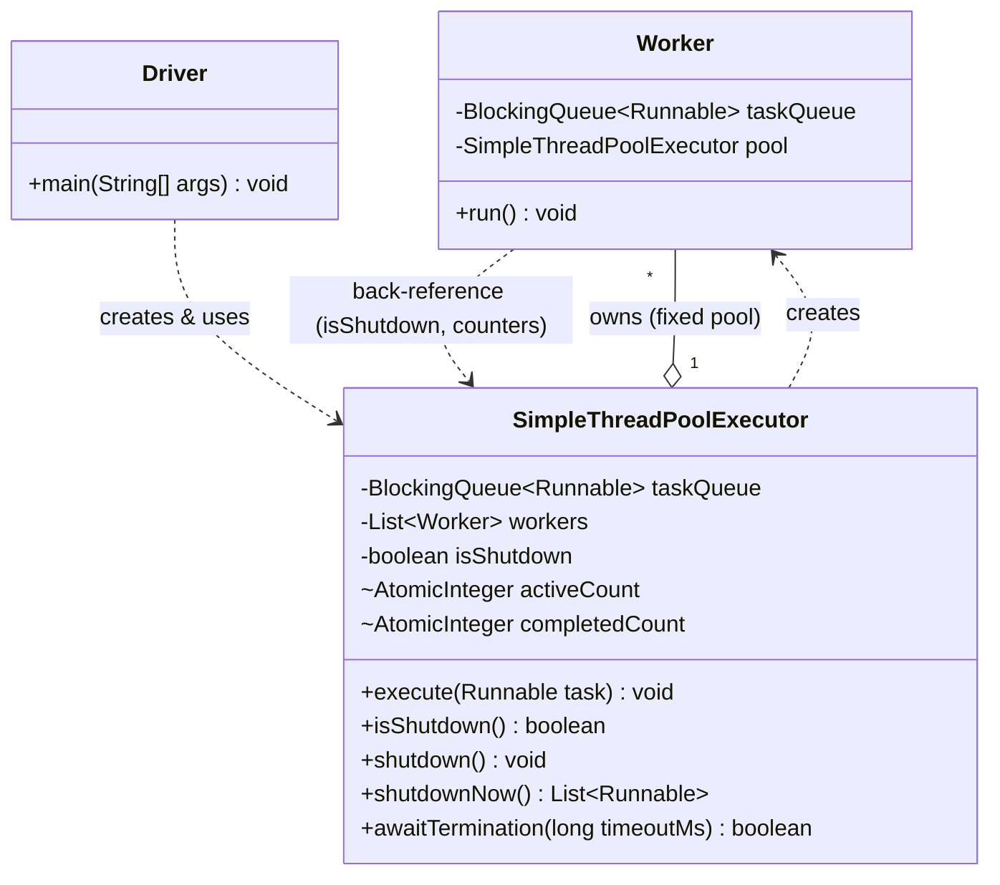

# Simple Thread Pool Executor — LLD / UML

Classes: `Worker`, `SimpleThreadPoolExecutor`, `simple_thread_pool_executor` (driver/main).

## Class diagram



## Box diagram (plain text)

```
┌───────────────────────────────────┐
│              Driver                │
│─────────────────────────────────── │
│ + main(String[] args): void        │
└───────────────────┬─────────────────┘
                    │ creates & uses
                    ▼
┌─────────────────────────────────────────────┐
│           SimpleThreadPoolExecutor            │
│───────────────────────────────────────────── │
│ - taskQueue: BlockingQueue<Runnable>          │
│ - workers: List<Worker>                       │
│ - isShutdown: boolean                         │
│ ~ activeCount: AtomicInteger                  │
│ ~ completedCount: AtomicInteger               │
│───────────────────────────────────────────── │
│ + execute(task): void                         │
│ + isShutdown(): boolean                       │
│ + shutdown(): void                            │
│ + shutdownNow(): List<Runnable>               │
│ + awaitTermination(timeoutMs): boolean        │
└───────────────────┬───────────────────────────┘
                    │ owns (1 ── *, fixed pool)   creates ▷
                    ▼
┌───────────────────────────────────┐
│               Worker                │
│  (extends Thread)                   │
│─────────────────────────────────── │
│ - taskQueue: BlockingQueue<Runnable>│
│ - pool: SimpleThreadPoolExecutor    │
│─────────────────────────────────── │
│ + run(): void                       │
└─────────────────────────────────────┘
```

Legend: `─▷` dependency (creates), `1──*` composition (owns via fixed worker list).

## Relationship notes (for talking through in an interview)

- **Composition (has-a):** `SimpleThreadPoolExecutor` *has-a* fixed list of `Worker` threads and the shared `taskQueue` they pull from. Workers are created once in the constructor and never replaced — no dynamic resizing, no core/max distinction like the real `java.util.concurrent.ThreadPoolExecutor`.
- **`Worker extends Thread`, not `implements Runnable`.** Keeping it a concrete `Thread` subclass with a back-reference to the pool (`pool.isShutdown()`, `pool.activeCount`) is the simplest way to let each worker both loop on the shared queue and report state back — one less indirection than wiring a separate `Runnable` + `Thread` pair per worker.
- **Back-reference, not composition:** `Worker` *depends on* `SimpleThreadPoolExecutor` to check shutdown state and bump the shared counters — a dependency in the opposite direction from ownership, which is why the diagram shows a dashed arrow both ways.
- **No `Future`/`Callable` support on purpose.** This design only accepts `Runnable` via `execute()` — no `submit()` returning a `Future<T>`, no result values, no exception propagation back to the caller. Keeping it fire-and-forget avoids modeling a `FutureTask` class and its state machine (NEW/COMPLETING/NORMAL/EXCEPTIONAL/CANCELLED), which is the real complexity in `java.util.concurrent`'s version.
- **No `RejectedExecutionHandler` strategy pattern.** The real `ThreadPoolExecutor` lets you plug in `AbortPolicy`, `CallerRunsPolicy`, `DiscardPolicy`, etc. This version has exactly one behavior: throw `RejectedExecutionException` if shut down, otherwise always accept (queue is unbounded). One less interface, one less thing to explain.

## One-sentence summary to say out loud

"There are really only two classes: `Worker`, a thread that loops pulling `Runnable` tasks off a shared queue and running them, and `SimpleThreadPoolExecutor`, which owns a fixed set of those workers plus the shared queue, and exposes `execute`/`shutdown`/`shutdownNow`/`awaitTermination` to control them."
